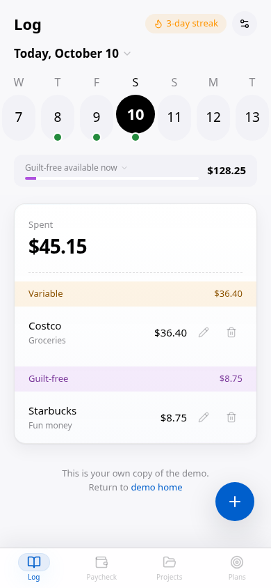
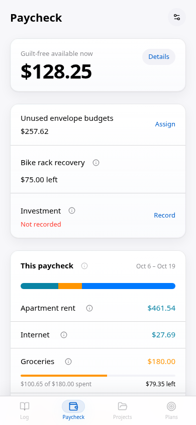
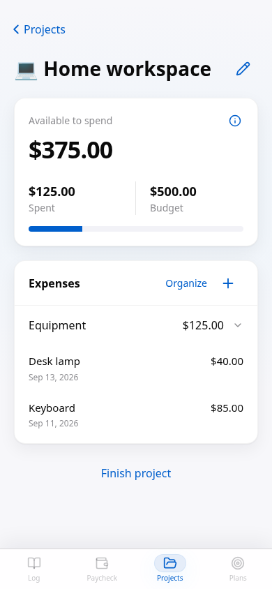
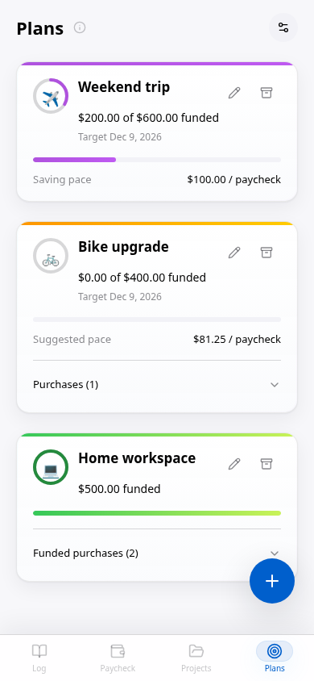
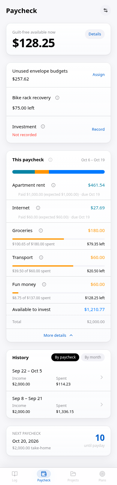

# Try it with made-up money

Open the [live demo](https://jings-finance-demo.vercel.app/demo) and choose **Start demo**. It opens Log without asking for an email or password. Your copy lasts 12 hours. Other visitors get their own copies.

The app works best on a phone. On a wider screen, choose **Proceed anyway** to try it there.

## One example across four screens

These pictures show one demo copy on October 10, 2026. I added a $36.40 Costco grocery purchase before taking them. No spending or funding changed between the four pictures.

A fresh demo uses the date you start it. Its dates will differ, but you can try the same steps with your own copy.

The example has $2,000 take-home pay every two weeks. Its monthly budgets are $1,000 for rent, $60 for Internet, $390 for Groceries, $130 for Transport, and $130 for Fun money.

## Log: what I spent today

Today has two purchases:

| Description | Envelope | Amount |
| --- | --- | --- |
| Costco | Groceries | $36.40 |
| Starbucks | Fun money | $8.75 |
| Total spent today | | $45.15 |

Fun money has **$128.25 left**. That includes money kept from earlier paychecks. The $45.15 spent today includes groceries too, so it is a different number.

To try a purchase, tap **+**, enter an amount and description, choose an envelope, and save. You can use any description you will remember, such as Costco or dinner with mom.

## Paycheck: where the money goes

Paycheck shows the same **$128.25** available for fun money. The current paycheck runs from October 6 through October 19.

Its breakdown sets aside money for bills and envelopes before showing **$1,210.77 available to invest**. That is a planning amount. No investment transfer has been recorded for this paycheck.

There is also **$257.62 of unused envelope budgets** from earlier paychecks waiting to be assigned. Choose **Assign** to give that money a place to go.

## Projects: what I bought for a Plan

Home workspace is a Project under the Home workspace Plan. It started with **$500 funded** and has two purchases in Equipment:

| Purchase | Amount |
| --- | --- |
| Keyboard | $85.00 |
| Desk lamp | $40.00 |
| Total spent | $125.00 |
| Money left to spend | $375.00 |

You can add groups such as Equipment or Parts to keep related purchases together. When the Project is finished, **Finish project** lets you review and release its unused funded money. This Project has not been finished yet.

## Plans: what the purchases belong to

The same **Home workspace** appears in Plans. Its **$500 funded** includes the $125 already used for its two funded purchases and the $375 still available. It does not mean there is another $500 to spend.

Weekend trip has $200 funded toward a $600 target. Saving from paychecks starts October 20, with a pace of $100 per paycheck toward December 9.

Bike upgrade has no funded money yet. Its $75 Bike rack purchase still needs funding. If you add money to Bike upgrade, the app covers that purchase first, then keeps any extra saved for later purchases.

## The full breakdown and history

This is the whole Paycheck page from the same demo copy, with its details open. **More details** shows the bill payments and remaining envelope money. Groceries has $79.35 left after the earlier Costco purchase and today's $36.40 purchase.

History keeps the earlier paycheck records together. The example includes rent and Internet payments, daily purchases, and earlier investment records.

| Earlier paycheck | Income | Spending |
| --- | --- | --- |
| September 8–21 | $2,000.00 | $1,336.15 |
| September 22–October 5 | $2,000.00 | $114.23 |

Open a History row to see its details, or choose **By month** to review a whole month.

Read the [user guide](USER_GUIDE.md) for more examples, or [install your own copy](INSTALL.md) to use the app for your own money.
